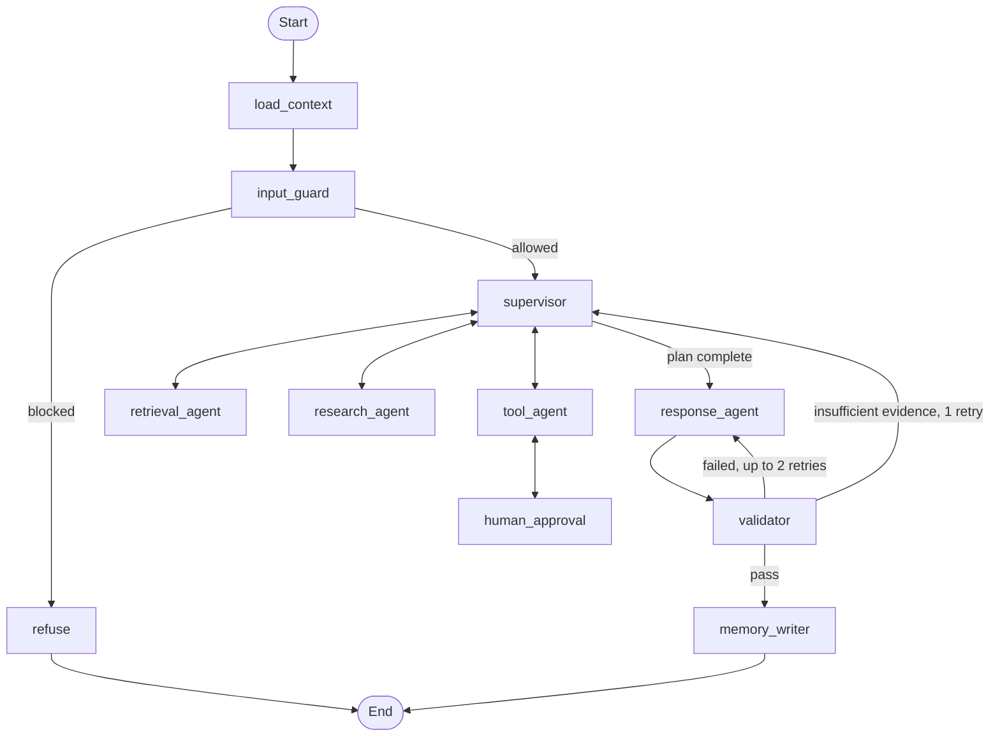
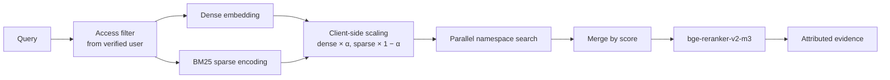
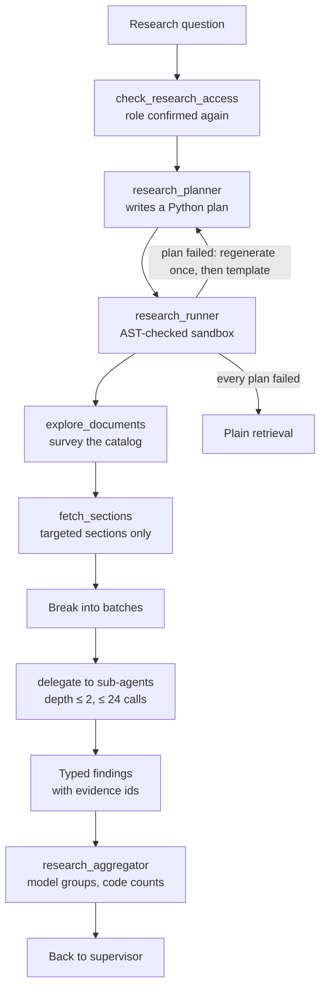

# Architecture

The Enterprise Knowledge Assistant answers Commercial Bank employees' questions from internal documents, with cited evidence. It is a multi-agent system with visible reasoning, role-based access and graceful degradation, rather than an LLM connected directly to a vector database.

Three principles drive the design:

1. **Access is never an LLM decision.** Roles come from a verified token, and filters are applied in code.
2. **Every claim is traceable.** Answers cite real chunks from the current turn, and each step appears in the UI and in LangSmith.
3. **Failures are contained.** Each dependency has a defined fallback, and one failed worker never fails the whole turn.

## System overview

```mermaid
flowchart LR
    user([Employee]) --> ui[Streamlit UI<br/>chat and activity panel]
    ui -- "HTTPS + SSE" --> api[FastAPI<br/>JWT auth, rate limit]
    api --> graph[LangGraph<br/>agent graph]
    api <--> redis[(Redis<br/>token buckets)]

    graph --> gateway[LLM gateway]
    gateway --> anthropic[Anthropic]
    gateway -.fallback.-> openai[OpenAI]
    gateway -.fallback.-> groq[Groq]

    graph --> retrieval[Hybrid retrieval]
    retrieval --> pinecone[(Pinecone<br/>dense + sparse)]
    retrieval -.fallback.-> bm25[Local BM25]

    graph --> tools[Tool registry]
    tools --> mcp[FastMCP server<br/>dummy enterprise data]
    tools --> sandbox[Python sandbox]

    graph <--> postgres[(Postgres<br/>checkpoints, memory,<br/>feedback, audit)]
    graph -. traces .-> langsmith[LangSmith]
```

## Agent graph



| Node | Responsibility | Model route |
|---|---|---|
| `load_context` | Resets per-turn state, loads the summary and long-term memory | None |
| `input_guard` | Checks the request for override, exfiltration and abuse attempts | `fast` |
| `refuse` | Returns a courteous refusal in the bank's voice | None |
| `supervisor` | Understands intent, decomposes the task, routes to workers | `response` |
| `retrieval_agent` | Runs hybrid search with reranking and attribution | None |
| `research_agent` | Runs the recursive RLM flow for large investigations | `response`, `fast` |
| `tool_agent` | Executes registered tools after role checks | None |
| `human_approval` | Pauses the graph until a person approves a write tool | None |
| `response_agent` | Writes the cited answer and streams a masked draft | `response` |
| `validator` | Checks citations, brand rules and answer validity | `fast` |
| `memory_writer` | Stores the summary, user facts and doc ids | `fast` |

Workers return typed records with evidence ids to the supervisor, never free text. Parallel work runs with `asyncio.gather`, in namespace search and in research sub-agents, because the sub-agents are started from inside the sandboxed plan rather than by a graph edge. Every loop is bounded by a named retry counter and by `recursion_limit`.

### Who owns which state

| Field | Written by | Lifetime |
|---|---|---|
| `user` | API, from the verified JWT; no node may change it | Conversation |
| `messages` | Graph | Conversation |
| `summary` | `memory_writer` | Conversation |
| `plan` | `supervisor` | One turn |
| `evidence` | `retrieval_agent`, `research_agent` | One turn |
| `errors`, `degraded` | Any node | One turn |
| `response_retries`, `evidence_retries` | `validator` | One turn |

The checkpointer keeps state between turns, so `load_context` resets the one-turn fields. Without this, an answer could cite evidence from an earlier turn.

## Retrieval



- **Index:** one Pinecone index with the `dotproduct` metric, holding a dense and a sparse vector per record, with one namespace per department.
- **Weighting:** α is 0.6 by default, and 0.3 when a query holds ids or error codes, because exact terms matter more there.
- **Attribution:** each chunk carries `doc_id`, `title`, `section`, `department`, `document_type`, `access_level`, `created_date` and `source_uri`.
- **Rerank budget:** only `retrieval_agent` reranks, because recursive research would otherwise exhaust the monthly quota.

## Recursive research (RLM)

Large questions never load whole documents into the LLM context. `research_agent` is a LangGraph subgraph: the planner writes a short Python plan, and the sandbox runs it using helpers that apply the access filter themselves. The plan handles only ids, titles and dates, and document text stays in the Python session.



Work moves down a level when a batch is too large for one sub-agent, or when a sub-agent reports that the section it was shown does not hold the answer.

Four choices keep the result honest:

- **The planner never sees document text,** only counts of what the employee may read, so a poisoned document cannot shape the code.
- **Citations are checked.** A sub-agent cites by document tag, and code maps those numbers to the chunks it was really shown.
- **Code does the counting.** The model decides which findings belong together, and code counts the documents, so a figure in an answer cannot be invented.
- **The answer uses findings, not chunks,** so the final prompt stays small however many documents were read.

The activity panel shows the generated plan, the batches, the recursion depth, and the chunks read against the total available. The real measure of coverage is documents analysed: in the payment-outage demo an analyst's plan reads all 22 incidents in scope, using 22 of the 154 chunks they may read, because it fetches only the section holding each root cause. Viewers get normal retrieval with a note ([ADR 0003](adr/0003-viewer-research-limit.md)), and the sandbox's limits are in [ADR 0001](adr/0001-sandbox-limits.md).

## Security layers

| Layer | Control |
|---|---|
| Identity | JWT verified by the API; the role never comes from the LLM |
| Rate limit | Per-user Redis token bucket, checked before the graph starts |
| Request | `input_guard`: deterministic patterns, then an LLM judge |
| Tools | Filtered at model binding, re-checked before execution, data filtered server-side |
| Retrieved text | Wrapped in document delimiters, and scanned by `content_guard` |
| Generated code | AST whitelist, restricted helpers, CPU limit, no imports |
| Output | Masked live draft, then `validator` and `output_guard` before the final answer, which keeps no web addresses |
| Memory | Doc ids only, namespaced by user, and scanned for injection |

The draft shown during streaming is provisional. It is masked and rendered as plain text, because rendering markdown would let an injected image URL send data out before validation runs.

## Failure containment

Each failure is contained where it occurs, recorded in `state["degraded"]`, and shown in the UI.

| Failure | What the user still gets |
|---|---|
| A model on a route | The next model on the route, then cited excerpts with no LLM |
| All guard judge models | Deterministic guards, with read tools only |
| Pinecone | BM25 search with the same access rules |
| Reranker or quota | Results in hybrid order |
| MCP or tool timeout | An answer from the remaining evidence |
| Invalid RLM plan | One regeneration, a fixed template plan, then plain retrieval |
| One research sub-agent | The other batches continue, and the gap is recorded |
| Research aggregator | Findings grouped by their own labels |
| Redis | An in-process token bucket |
| Postgres | An in-memory checkpointer, with long-term memory off |
| Invalid request | A structured 422 error |
| Rate limit exceeded | A 429 response with `Retry-After` |

## Memory

| Tier | Holds | Storage |
|---|---|---|
| Thread | Messages of this conversation | `AsyncPostgresSaver`, by `thread_id` |
| Summary | Rolling summary of older turns | Thread state |
| Long-term | User facts and doc ids, never document text | `AsyncPostgresStore`, by `user_id` |

## Observability

Every conversation, agent transition, tool call and retrieval operation is traced in LangSmith, with `user_id`, `role` and `thread_id` as run metadata. The same steps stream to the activity panel as typed events, and a `trace` event follows each answer with a link to its trace. Traces show the structure of a turn and which chunks were used, but document text and research findings are redacted before they leave the process. Logs are structured JSON and never contain tokens, JWTs or document text.

## Decisions

Assumptions and trade-offs are recorded in [docs/adr/](adr/).
